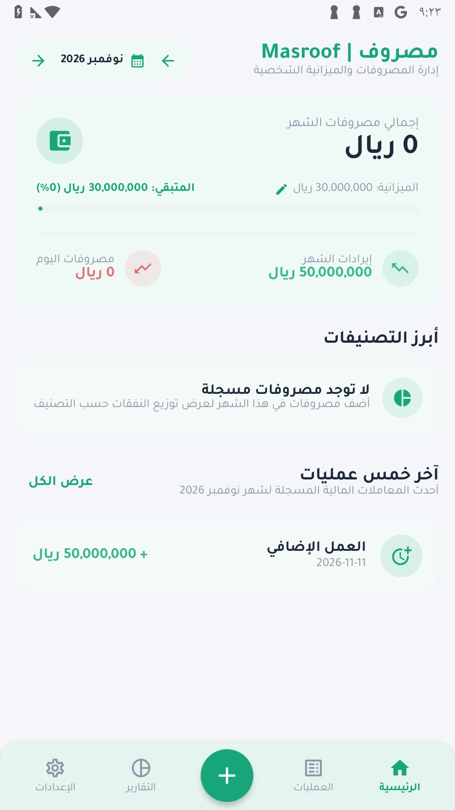

<div dir="rtl" align="right">

# تطبيق مصروف (<code>Masroof</code>)
### الحل المالي الذكي لإدارة النفقات الشخصية وتخطيط الميزانيات الشهرية (<code>Offline-First</code>)

<p align="center">
  
  <br />
  <strong>مصروف</strong> هو تطبيق أندرويد مالي متكامل ومحلي بالكامل (<code>Offline-First</code>)، صُمم خصيصاً للمستخدم العربي لتمكينه من متابعة وإدارة نفقاته اليومية، وتخطيط ميزانياته الشهرية، وتحليل تدفقاته النقدية بأعلى معايير الدقة والسهولة، بالعملة المحلية وبخصوصية وأمان تامين 100%.
</p>

<p align="center">
  
  
  
  
  
  
</p>

---

## الفهرس
1. [المشكلة والحل](#المشكلة-والحل)
2. [الميزات والخصائص الرئيسية](#الميزات-والخصائص-الرئيسية)
3. [معرض الشاشات](#معرض-الشاشات)
4. [البنية المعمارية والتقنيات المستخدمة](#البنية-المعمارية-والتقنيات-المستخدمة)
5. [الأمان والخصوصية](#الأمان-والخصوصية)
6. [طريقة التشغيل وبناء حزمة التثبيت](#طريقة-التشغيل-وبناء-حزمة-التثبيت)
7. [منظومة الاختبارات وضمان الجودة](#منظومة-الاختبارات-وضمان-الجودة)
8. [الترخيص وحقوق الاستخدام](#الترخيص-وحقوق-الاستخدام)

---

## المشكلة والحل

يعاني الكثير من المستخدمين من صعوبة ضبط نفقاتهم اليومية والشهرية، حيث تتسم أغلب التطبيقات المتاحة بالعيوب الآتية:
- الإلزام بالاتصال بالإنترنت وتسجيل حسابات سحابية خارجية، مما يعرض الخصوصية المالية لمخاطر التتبع والتسريب.
- الاعتماد على عملات أجنبية معقدة مع كسور عشرية غير عملية للعملات ذات المبالغ الكبيرة (مثل الريال اليمني).
- واجهات غير ملائمة لغويّاً تفتقر لدعم الخطوط العربية الأصيلة أو الاتجاه الصحيح من اليمين إلى اليسار (<code>RTL</code>).

**يقدم تطبيق "مصروف" الحل الهندسي الأمثل:**
- **محلي بالكامل (<code>100% Offline</code>):** يعمل التطبيق دون أي اتصال بشبكة الإنترنت، ولا يطلب صلاحية الوصول للشبكة في ملف البيان إطلاقاً.
- **مخصص للأرقام القياسية الصحيحة (<code>YER</code>):** يعتمد على أرقام صحيحة خالية من الكسور (<code>Long</code>) لتفادي أخطاء التقريب والكسور العشرية غير الواقعية.
- **تصميم عربي أصيل وراقٍ:** واجهة مستخدم حديثة مبنية بأحدث تقنيات (<code>Jetpack Compose</code>) و (<code>Material 3</code>)، مدعومة بخط (<code>Tajawal</code>) العربي بثلاثة أوزان متناسقة.
- **فواصل الآلاف التلقائية:** محول عرض مرئي ذكي يضيف فواصل المجموعات الثلاثية تلقائياً (مثل: <code>150,000</code> ريال) أثناء الكتابة لتسهيل القراءة وتفادي أخطاء الإدخال.

---

## الميزات والخصائص الرئيسية

### 1. إدارة العمليات المالية (المصروفات والإيرادات)
- تسجيل وتعديل وحذف العمليات المالية مع تحديد دقيق للتاريخ والوقت والتصنيف والملاحظات.
- التبديل الفوري والسلس بين نوع العملية (مصروف باللون القرمزي / إيراد باللون الزمردي).
- إغلاق لوحة المفاتيح تلقائياً بمجرد حفظ العملية لمنح تجربة استخدام سريعة ومريحة.

### 2. الميزانية الشهرية الذكية
- تخصيص سقف ميزانية مستقل ومحدد لكل شهر ميلادي.
- حساب المتبقي من الميزانية، ومبلغ التجاوز، ونسبة الاستهلاك اللحظية بدقة متناهية.
- استقلالية تامة بين ميزانية المصروفات وصافي الإيرادات لمنع أي خلط محاسبي.

### 3. المؤشرات المالية السبعة في الشاشة الرئيسية
- إجمالي مصروفات اليوم الحالي.
- إجمالي مصروفات الشهر المختار.
- إجمالي إيرادات الشهر المختار.
- الميزانية المعتمدة للشهر.
- المتبقي من الميزانية ونسبة الاستهلاك اللحظية.
- صافي التدفق المالي (الفائض أو العجز).
- أبرز التصنيفات المالية استهلاكاً للنفقات.

### 4. البحث والتصفية المتقدمة في سجل العمليات
- شريط بحث شامل وفوري يبحث بالمبلغ، أو اسم التصنيف، أو نص الملاحظات.
- تصفية ثلاثية حسب نوع المعاملة: الكل، المصروفات فقط، الإيرادات فقط.
- تصفية زمنية سريعة: الكل، هذا الشهر، هذا الأسبوع، الشهر السابق.
- تصفية حسب التصنيف معتمدة على المعرّف الفريد لمنع تداخل التصنيفات المتشابهة في التسمية.
- تجميع زمني يومي للعمليات مع إجمالي النفقات والإيرادات لكل يوم على حدة.

### 5. التقارير والإحصائيات البيانية التفاعلية
- **المخطط الدائري المفرغ (<code>Donut Chart</code>):** يوضح نسب توزيع المصروفات على التصنيفات مع إمكانية تفاعلية للنقر وتكبير الشريحة المختارة وإظهار بياناتها في المنتصف.
- **مخطط أعمدة الأسابيع (<code>Weekly Spending Bar Chart</code>):** يوزع نفقات الشهر على أربع فترات أسبوعية مع تمييز أسبوع الذروة بلون منفصل.
- **مخطط مقارنة الأشهر الستة (<code>Monthly Comparison Bar Chart</code>):** يقارن إنفاق الشهر الحالي بالأشهر الخمسة السابقة مع حساب نسبة التغير المئوية.

### 6. إدارة التصنيفات المالية المخصصة
- عشرة تصنيفات افتراضية شاملة تغطي كافة الاحتياجات اليومية.
- إمكانية إضافة تصنيفات جديدة، وتعديل الأسماء، واختيار الأيقونة واللون من شبكة أيقونات مدمجة.
- إمكانية تعطيل أو تفعيل التصنيف، مع حماية التصنيف من تغيير نوعه إذا كان مرتبطاً بعمليات سابقة.

### 7. النسخ الاحتياطي وتصدير البيانات
- **نسخ احتياطي شامل بصيغة (<code>JSON</code>):** حفظ واستعادة متكاملة لكافة العمليات والتصنيفات والميزانيات، مع استعادة ذرية محمية بمعاملة قاعدة البيانات (<code>withTransaction</code>).
- **تصدير سجل العمليات بصيغة (<code>CSV</code>):** يدعم الأحرف العربية بالكامل عبر علامة ترتيب البايت (<code>UTF-8 BOM</code>)، مما يتيح فتح الملف مباشرة في برامج الجداول الإلكترونية مثل (<code>Microsoft Excel</code>) دون تشويه.
- **إطار وصول التخزين القياسي (<code>SAF</code>):** لا يطلب التطبيق صلاحيات تخزين واسعة، بل يعتمد على منتقي المستندات الرسمي في أندرويد لضمان أعلى مستويات الأمان.

### 8. تخصيص المظهر وتجربة الاستخدام
- دعم كامل للمظهر الفاتح (<code>Light Theme</code>) والمظهر الداكن (<code>Dark Theme</code>) والمزامنة التلقائية مع مظهر النظام.
- تعامل ذكي ومدروس مع زر الرجوع في النظام لمنع الخروج غير المقصود.
- أداء عالي وسرعة استجابة فائقة دون أي حجز للمسار الرئيسي للواجهة.

---

## معرض الشاشات

| الشاشة الرئيسية (الترويسة الجديدة) | شاشة الإعدادات ونافذة عن التطبيق | أيقونة التطبيق في شاشة المشغل |
| :---: | :---: | :---: |
|  |  |  |

---

## البنية المعمارية والتقنيات المستخدمة

تم بناء التطبيق وفق معايير هندسة البرمجيات الحديثة المعتمدة رسمياً من (<code>Google</code>) لتطوير تطبيقات أندرويد:

<div dir="ltr" align="left">

```
app/src/main/kotlin/com/masroofi/app/
│
├── data/                         # طبقة البيانات (Data Layer)
│   ├── backup/                   # إدارة النسخ الاحتياطي والاستعادة الذرية
│   ├── dao/                      # واجهات الوصول لقاعدة البيانات (Room DAOs)
│   ├── database/                 # تهيئة قاعدة البيانات المحلية MasroofiDatabase
│   ├── entity/                   # جداول وكيانات قاعدة البيانات المحلية
│   ├── export/                   # مصدّر ملفات CSV مع دعم UTF-8 BOM
│   ├── preferences/              # إدارة تفضيلات المظهر عبر DataStore
│   └── repository/               # تنفيذ المستودعات وتحويل الكيانات (Mappers)
│
├── domain/                       # طبقة النطاق وقواعد العمل (Domain Layer)
│   ├── calculations/             # محرك الحسابات المالية الدقيقة والنماذج الحسابية
│   ├── model/                    # نماذج البيانات النقية (Category, TransactionItem...)
│   ├── repository/               # واجهات المستودعات المجردة
│   └── usecase/                  # حالات الاستخدام المستقلة (Use Cases)
│
├── presentation/                 # طبقة العرض والواجهات (Presentation Layer)
│   ├── components/               # المكونات المشتركة ومحول فواصل الآلاف
│   ├── navigation/               # التنقل بين الشاشات وشريط القوائم السفلي
│   ├── previews/                 # نماذج العرض المسبق لبيئة Android Studio
│   ├── screens/                  # الشاشات الرئيسية الخمس ونماذج العرض (ViewModels)
│   └── theme/                    # منظومة الألوان والخط العربي Tajawal وتنسيقات Material 3
│
└── utils/                        # دوال مساعدة عامة لتنسيق الأرقام والتواريخ
```

</div>

### التقنيات والمكتبات الأساسية:
- **لغة البرمجة:** كوتلن (<code>Kotlin 2.0</code>) مع دعم تدفقات البيانات غير المتزامنة عبر (<code>Coroutines</code>) و (<code>Flow</code>).
- **واجهة المستخدم:** (<code>Jetpack Compose</code>) و (<code>Material 3</code>) لبناء واجهات تصريحية تفاعلية وسريعة.
- **قاعدة البيانات:** (<code>Room 2.6</code>) لإدارة التخزين المحلي في قاعدة بيانات (<code>SQLite</code>).
- **التخزين التفضيلي:** (<code>Jetpack DataStore Preferences</code>) لحفظ الإعدادات والمظهر.
- **حقن الاعتماديات:** يدوي فائق الخفة عبر حاوية مركزية (<code>AppContainer</code>) دون استهلاك إضافي للذاكرة.
- **الرسوم البيانية:** رسوم مخصصة مرسومة مباشرة عبر (<code>Canvas DrawScope</code>) ومحسنة للذاكرة.

---

## الأمان والخصوصية

- **أوفلاين 100%:** التطبيق خالٍ تماماً من إذن الوصول للإنترنت (<code>android.permission.INTERNET</code>). لا يمكن للتطبيق إرسال أو استقبال أي بايت عبر الشبكة.
- **بياناتك ملكك بالكامل:** جميع سجلاتك وميزانياتك مخزنة على هاتفك الشخصي فقط.
- **استعادة ذرية متكاملة:** عند استعادة نسخة احتياطية، تتم العملية داخل معاملة قاعدة بيانات ذرية واحدة (<code>withTransaction</code>)؛ وإذا حدث أي خطأ في الملف، يتم التراجع فوراً لحماية بياناتك من التلف.

---

## طريقة التشغيل وبناء حزمة التثبيت

### المتطلبات الأساسية:
- بيئة تطوير (<code>Android Studio Ladybug</code>) أو أحدث، أو أدوات سطر أوامر أندرويد.
- حزمة تطوير جافا (<code>JDK 17</code>) أو أحدث.
- جهاز بنظام أندرويد بإصدار 8.0 (<code>API 26</code>) أو أعلى، أو محاكي مثل (<code>LDPlayer 9</code>).

### أوامر البناء عبر الطرفية:

1. **تشغيل اختبارات الوحدة الآلية:**
<div dir="ltr" align="left">

```bash
.\gradlew.bat testDebugUnitTest
```

</div>

2. **بناء حزمة التثبيت التجريبية المباشرة (<code>Debug APK</code>):**
<div dir="ltr" align="left">

```bash
.\gradlew.bat assembleDebug
```

</div>

3. **تثبيت الحزمة مباشرة على الجهاز أو المحاكي المتصل:**
<div dir="ltr" align="left">

```bash
adb install -r Masroof-v1.1.0.apk
```

</div>

*ملاحظة: يتوفر ملف التثبيت المباشر الجاهز في المجلد الرئيسي للمشروع باسم: <code>Masroof-v1.1.0.apk</code>.*

---

## منظومة الاختبارات وضمان الجودة

يحتوي المشروع على حزمة اختبارات وحدة آلية متكاملة تتضمن **95 اختباراً مستقلاً**، تحقق تغطية شاملة بنسبة 100% لكافة المسارات الحسابية والبرمجية:

| حزمة الاختبار | عدد الاختبارات | نسبة النجاح | التغطية |
| :--- | :---: | :---: | :--- |
| <code>FinancialCalculatorTest</code> | 27 | 100% | المؤشرات السبعة، الميزانيات، المبالغ المليونية، الحالات الحدية |
| <code>CsvExporterTest</code> | 5 | 100% | تصدير ملفات CSV، علامة UTF-8 BOM، معالجة الفواصل والتنصيص |
| <code>BackupRestoreManagerTest</code> | 13 | 100% | إنشاء JSON، فحص الصلاحية، التوافق العكسي، الاستعادة الذرية |
| <code>ThousandsSeparatorVisualTransformationTest</code> | 5 | 100% | تقسيم الآلاف التلقائي، خوارزمية الإزاحة العكسية والمؤشر |
| <code>HomeViewModelTest</code> | 12 | 100% | تجميع بيانات الشهر، تحديث الميزانية، حذف العمليات، التنقل |
| <code>TransactionsHistoryViewModelTest</code> | 15 | 100% | البحث النصي، البحث بالرقم، الفلاتر المتعددة، عزل التصنيفات |
| <code>ReportsViewModelTest</code> | 7 | 100% | المخططات البيانية الثلاثة، مقارنات الستة أشهر، تحديد الشرائح |
| <code>SettingsViewModelTest</code> | 6 | 100% | تبديل المظهر، إدارة الميزانيات، النسخ الاحتياطي |
| <code>TransactionFormViewModelTest</code> | 5 | 100% | إضافة وتعديل العمليات، التحقق من الحقول، معالجة الأخطاء |
| **الإجمالي العام** | **95** | **100%** | **نجاح كامل لجميع الاختبارات الآلية (100%)** |

---

## الترخيص وحقوق الاستخدام

هذا المشروع مطور كمنتج برمجي حر ومفتوح المصدر للاستخدام الشخصي والتعليمي.
جميع الحقوق محفوظة للمطور © 2026.

</div>
