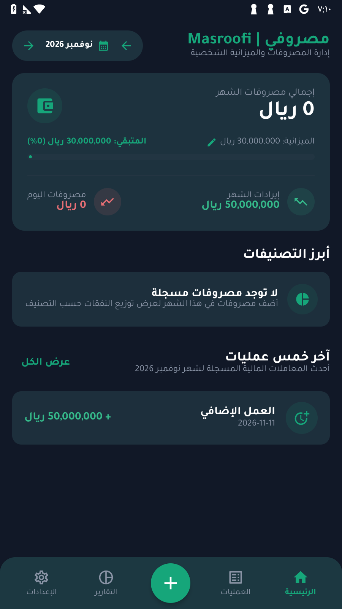
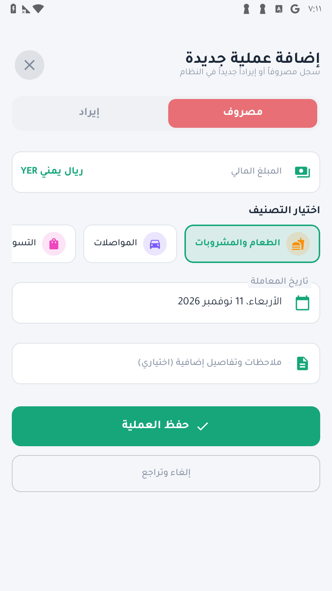
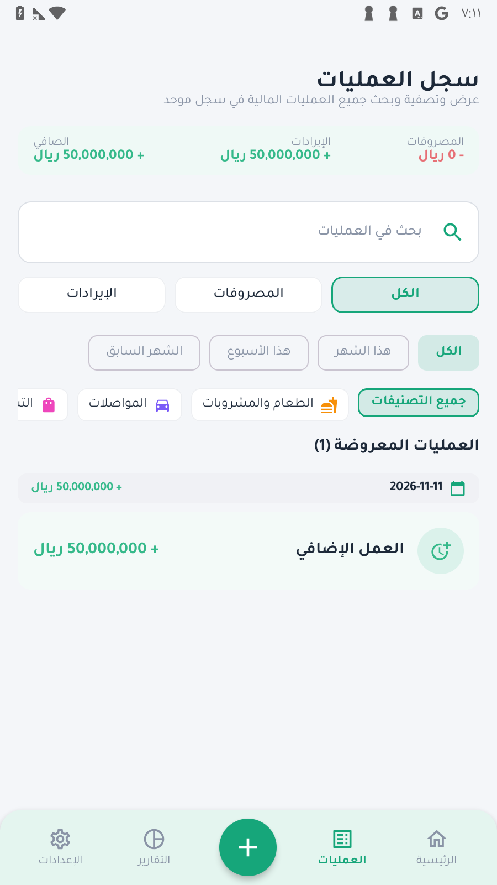
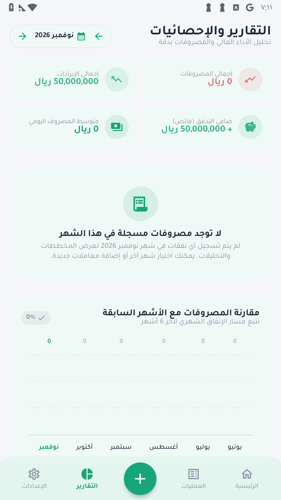
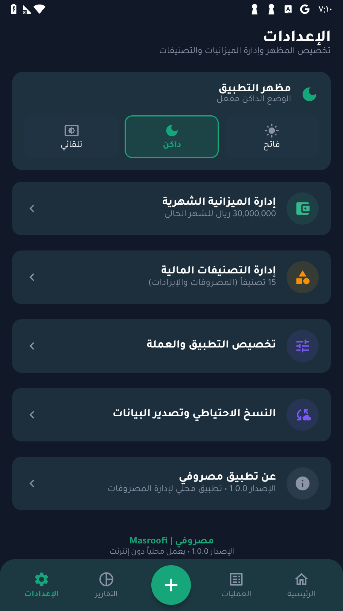
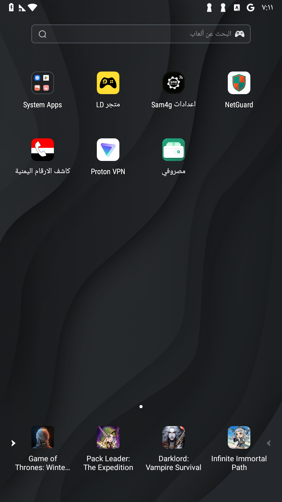

# مصروفي | Masroofi
### تطبيق أندرويد شخصي ذكي لإدارة المصروفات والميزانية الشهرية (Offline-First)

<p align="center">
  
  <br />
  <strong>مصروفي</strong> هو تطبيق أندرويد محلي متكامل (`Offline-First`) مصمم خصيصاً للمستخدم العربي لمتابعة وإدارة النفقات اليومية، وتخطيط الميزانيات الشهرية، وتحليل التدفقات المالية بدقة وسهولة متناهية، بالعملة المحلية (الريال اليمني YER) وبخصوصية تامة 100%.
</p>

<p align="center">
  
  
  
  
  
  
</p>

---

## الفهرس
1. [المشكلة والحل](#المشكلة-والحل)
2. [الميزات والخصائص الرئيسية](#الميزات-والخصائص-الرئيسية)
3. [معرض الشاشات](#معرض-الشاشات)
4. [البنية المعمارية والتقنيات المستخدمة](#البنية-المعمارية-والتقنيات-المستخدمة)
5. [الأمان والخصوصية](#الأمان-والخصوصية)
6. [طريقة التشغيل وبناء حزمة التثبيت (APK)](#طريقة-التشغيل-وبناء-حزمة-التثبيت-apk)
7. [منظومة الاختبارات وضمان الجودة](#منظومة-الاختبارات-وضمان-الجودة)
8. [الترخيص وحقوق الاستخدام](#الترخيص-وحقوق-الاستخدام)

---

## المشكلة والحل

يعاني الكثير من المستخدمين من صعوبة تتبع نفقاتهم اليومية والشهرية، حيث تعتمد أغلب التطبيقات المتوفرة على:
- الحاجة الدائمة للاتصال بالإنترنت وتسجيل حسابات خارجية قد تعرض الخصوصية المالية للخطر.
- دعم عملات أجنبية معقدة مع كسور مالية غير عملية للعملات ذات الأرقام الكبيرة (مثل الريال اليمني).
- واجهات غير معربة بالشكل الكافي تفتقر لدعم الخطوط العربية الأصيلة أو الاتجاه الصحيح من اليمين إلى اليسار (`RTL`).

**يقدم تطبيق "مصروفي" الحل الأمثل:**
- **محلي بالكامل (`100% Offline`):** يعمل التطبيق دون أي اتصال بشبكة الإنترنت، ولا يطلب صلاحية الوصول للشبكة في ملف البيان إطلاقاً.
- **مخصص للريال اليمني (`YER`):** يعتمد على أرقام صحيحة خالية من الكسور (`Long`) لتفادي أي أخطاء حسابية أو كسور عشرية غير واقعية.
- **تصميم عربي راقٍ:** واجهة مستخدم مبنية بـ `Jetpack Compose` و `Material 3` مدعومة بخط `Tajawal` الأصلي بثلاثة أوزان متناسقة.
- **فواصل الآلاف التلقائية:** محول عرض مرئي ذكي يضيف فواصل المجموعات الثلاثية تلقائياً (`150,000` ريال) أثناء الكتابة لتسهيل القراءة وتفادي أخطاء الإدخال في المبالغ الكبيرة.

---

## الميزات والخصائص الرئيسية

### 1. إدارة المعاملات المالية (المصروفات والإيرادات)
- إضافة وتعديل وحذف المعاملات مع اختيار التاريخ والوقت والتصنيف والملاحظات التوضيحية.
- التبديل السلس بين نوع المعاملة (مصروف أحمر / إيراد أخضر).
- لوحة مفاتيح تفاعلية تغلق تلقائياً عند حفظ العملية.

### 2. الميزانية الشهرية الذكية
- تحديد سقف ميزانية مستقل ومخصص لكل شهر ميلادي.
- حساب المتبقي من الميزانية، ومبلغ التجاوز، ونسبة الاستهلاك اللحظية بدقة.
- استقلالية كاملة بين ميزانية المصروفات وصافي الإيرادات لمنع أي خلط محاسبي.

### 3. المؤشرات المالية السبعة في الشاشة الرئيسية
- إجمالي مصروفات اليوم.
- إجمالي مصروفات الشهر المختار.
- إجمالي إيرادات الشهر المختار.
- الميزانية المعتمدة للشهر.
- المتبقي من الميزانية ونسبة الاستهلاك.
- صافي التدفق المالي (الفائض أو العجز).
- أبرز التصنيفات استهلاكاً للمصروفات.

### 4. البحث والتصفية المتقدمة في سجل العمليات
- شريط بحث شامل يبحث فورياً بالمبلغ، أو اسم التصنيف، أو نص الملاحظات.
- تصفية ثلاثية حسب نوع المعاملة: الكل، المصروفات، الإيرادات.
- تصفية زمنية سريعة: الكل، هذا الشهر، هذا الأسبوع، الشهر السابق.
- تصفية حسب التصنيف المالي معتمدة على المعرّف الفريد لمنع اختلاط التصنيفات المشتركة في الاسم (مثل "أخرى").
- تجميع زمني يومي للعمليات مع إجمالي النفقات والإيرادات اليومية.

### 5. التقارير والإحصائيات البيانية المخصصة
- **المخطط الدائري المفرغ (`Donut Chart`):** يوضح نسب توزيع المصروفات على التصنيفات مع ميزة تفاعلية لتكبير الشريحة المختارة وإظهار تفاصيلها في المركز.
- **مخطط أعمدة الأسابيع (`Weekly Spending Bar Chart`):** يوزع نفقات الشهر على 4 فترات أسبوعية مع إبراز أسبوع الذروة باللون المميز.
- **مخطط مقارنة الأشهر الستة (`Monthly Comparison Bar Chart`):** يقارن إنفاق الشهر الحالي مع الأشهر الخمسة السابقة مع حساب نسبة التغير المئوية.

### 6. إدارة التصنيفات المخصصة
- 10 تصنيفات افتراضية تغطي كافة الاحتياجات الحياتية.
- إمكانية إضافة تصنيفات جديدة، وتعديل الأسماء، واختيار الأيقونة والألوان من شبكة أيقونات مدمجة.
- إمكانية تفعيل أو تعطيل التصنيف، مع قفل نوع التصنيف إذا كان مرتبطاً بمعاملات تاريخية سابقة لحماية تماسك البيانات.

### 7. النسخ الاحتياطي وتصدير البيانات
- **نسخ احتياطي كامل بصيغة `JSON`:** حفظ واسترجاع شامل لكافة المعاملات والتصنيفات والميزانيات والتفضيلات، مع استعادة ذرية محمية بمعاملة قاعدة البيانات (`withTransaction`).
- **تصدير سجل العمليات بصيغة `CSV`:** يدعم الأحرف العربية بالكامل بفضل علامة ترتيب البايت `UTF-8 BOM`، مما يتيح فتح الملف مباشرة في برنامج `Microsoft Excel` دون أي تشويه للنصوص.
- **إطار وصول التخزين القياسي (`SAF`):** لا يتطلب التطبيق صلاحيات تخزين خارجية واسعة أو خطرة، بل يعتمد على منتقي المستندات الرسمي في أندرويد.

### 8. تخصيص المظهر وتجربة الاستخدام
- دعم كامل للوضع الفاتح (`Light Theme`) والوضع الداكن (`Dark Theme`) والمزامنة مع مظهر النظام.
- سلوك ذكي ومدروس لزر الرجوع في النظام (`BackHandler`).
- أداء فائق وسرعة تشغيل غير معطلة على الإطلاق للمسار الرئيسي (`Zero Main Thread Blocking`).

---

## معرض الشاشات

| الشاشة الرئيسية (الوضع الفاتح) | الشاشة الرئيسية (الوضع الداكن) | شاشة إضافة عملية |
| :---: | :---: | :---: |
|  |  |  |

| سجل العمليات والتصفية | التقارير والمخططات البيانية | شاشة الإعدادات |
| :---: | :---: | :---: |
|  |  |  |

<p align="center">
  <strong>أيقونة التطبيق الزمردية في شاشة الهاتف الرئيسية:</strong><br/>
  
</p>

---

## البنية المعمارية والتقنيات المستخدمة

تم بناء التطبيق باتباع معايير هندسة البرمجيات الحديثة الموصى بها رسمياً من Google لتطوير تطبيقات أندرويد:

```
app/src/main/kotlin/com/masroofi/app/
│
├── data/                         # طبقة البيانات (Data Layer)
│   ├── backup/                   # إدارة النسخ الاحتياطي JSON والاستعادة الذرية
│   ├── dao/                      # واجهات الوصول لقاعدة البيانات (Room DAOs)
│   ├── database/                 # تهيئة قاعدة البيانات المحلية MasroofiDatabase
│   ├── entity/                   # جداول وكيانات قاعدة البيانات المحلية
│   ├── export/                   # مصدّر ملفات CSV مع دعم UTF-8 BOM
│   ├── preferences/              # إدارة تفضيلات المظهر عبر DataStore
│   └── repository/               # تنفيذ المستودعات وتحويل الكيانات (Mappers)
│
├── domain/                       # طبقة النطاق وقواعد العمل (Domain Layer)
│   ├── calculations/             # محرك الحسابات المالية الدقيقة والنماذج الحسابية
│   ├── model/                    # نماذج البيانات النقية (Category, TransactionItem...)
│   ├── repository/               # واجهات المستودعات المجردة
│   └── usecase/                  # حالات الاستخدام المستقلة (Use Cases)
│
├── presentation/                 # طبقة العرض والواجهات (Presentation Layer)
│   ├── components/               # المكونات المشتركة ومحول فواصل الآلاف
│   ├── navigation/               # التنقل بين الشاشات وشريط القوائم السفلي
│   ├── previews/                 # نماذج العرض المسبق لبيئة Android Studio
│   ├── screens/                  # الشاشات الرئيسية الخمس ونماذج العرض (ViewModels)
│   └── theme/                    # منظومة الألوان والخط العربي Tajawal وتنسيقات Material 3
│
└── utils/                        # دوال مساعدة عامة لتنسيق الأرقام والتواريخ
```

### التقنيات والمكتبات الأساسية:
- **لغة البرمجة:** `Kotlin 2.0` (مع دعم Coroutines و Flow لإدارة التدفقات التفاعلية غير المتزامنة).
- **واجهة المستخدم:** `Jetpack Compose` و `Material 3` لواجهات تفاعلية حديثة وسريعة.
- **قاعدة البيانات:** `Room 2.6` لإدارة التخزين المحلي في قاعدة بيانات SQLite محلية.
- **التخزين التفضيلي:** `Jetpack DataStore Preferences` لحفظ مظهر التطبيق.
- **حقن الاعتماديات:** يدوي خفيف الوزن عبر حاوية مركزية `AppContainer` بدون أي عبء إضافي لوقت التشغيل.
- **الرسوم البيانية:** رسوم تفاعلية مرسومة بالكامل عبر `Canvas DrawScope` ومحسنة ضد التخصيص المتكرر للذاكرة.

---

## الأمان والخصوصية

- **أوفلاين 100%:** التطبيق لا يحتوي على إذن `android.permission.INTERNET`. لا يمكن للتطبيق إرسال أو استقبال أي بيانات عبر الإنترنت تحت أي ظرف.
- **بياناتك ملكك بالكامل:** جميع سجلاتك المالية، وميزانياتك، وتصنيفاتك مخزنة على وحدة التخزين المشفرة الخاصة بهاتفك.
- **استعادة ذرية محمية:** عند استعادة نسخة احتياطية سابقة، يتم تنفيذ العملية في معاملة ذرية واحدة (`db.withTransaction`). في حال حدوث أي خطأ في الملف أو تلف، يتم التراجع فوراً لتبقى بياناتك سالمة دون أي فقدان.

---

## طريقة التشغيل وبناء حزمة التثبيت (APK)

### المتطلبات الأساسية:
- بيئة تطوير `Android Studio Ladybug` أو أحدث، أو أدوات سطر أوامر أندرويد.
- حزمة تطوير جافا `JDK 17` أو أحدث.
- جهاز بنظام أندرويد بإصدار 8.0 (API 26) أو أعلى، أو محاكي مثل `LDPlayer` أو محاكي أندرويد الرسمي.

### أوامر البناء عبر الطرفية (`Terminal`):

1. **تشغيل اختبارات الوحدة الآلية:**
   ```bash
   .\gradlew.bat testDebugUnitTest
   ```

2. **بناء حزمة APK التجريبية / القابلة للتثبيت المباشر:**
   ```bash
   .\gradlew.bat assembleDebug
   ```

3. **تثبيت حزمة APK مباشرة على الجهاز أو المحاكي المتصل:**
   ```bash
   adb install -r Masroofi-v1.0.0.apk
   ```

*ملاحظة: يمكنك الوصول إلى ملف التثبيت المباشر الجاهز فوراً من المجلد الرئيسي للمشروع باسم: `Masroofi-v1.0.0.apk`.*

---

## منظومة الاختبارات وضمان الجودة

يحتوي المشروع على حزمة اختبارات وحدة آلية متكاملة تتضمن **95 اختباراً مستقلاً**، تحقق تغطية شاملة لكافة المسارات الحسابية والبرمجية:

| حزمة الاختبار | عدد الاختبارات | نسبة النجاح | التغطية |
| :--- | :---: | :---: | :--- |
| `FinancialCalculatorTest` | 27 | 100% | المؤشرات السبعة، الميزانيات، المبالغ المليونية، حالات الحدود |
| `CsvExporterTest` | 5 | 100% | تصدير CSV، علامة UTF-8 BOM، معالجة الفواصل والتنصيص |
| `BackupRestoreManagerTest` | 13 | 100% | إنشاء JSON، فحص الصلاحية، الاستعادة الذرية، معالجة تلف البيانات |
| `ThousandsSeparatorVisualTransformationTest` | 5 | 100% | تقسيم الآلاف التلقائي، خوارزمية الإزاحة العكسية والمؤشر |
| `HomeViewModelTest` | 12 | 100% | تجميع بيانات الشهر، تحديث الميزانية، حذف العمليات، التنقل |
| `TransactionsHistoryViewModelTest` | 15 | 100% | البحث النصي، البحث بالرقم، الفلاتر المتعددة، عزل التصنيفات |
| `ReportsViewModelTest` | 7 | 100% | المخططات الثلاثة، مقارنات الستة أشهر، تحديد الشرائح |
| `SettingsViewModelTest` | 6 | 100% | تبديل المظهر، إدارة الميزانيات، النسخ الاحتياطي |
| `TransactionFormViewModelTest` | 5 | 100% | إضافة وتعديل المعاملات، فحص الأخطاء، التحقق من الحقول |
| **الإجمالي العام** | **95** | **100%** | **نجاح كامل لكافة الاختبارات الآلية** |

---

## الترخيص وحقوق الاستخدام

هذا المشروع مطور كمنتج برمجي حر ومفتوح المصدر للاستخدام الشخصي والتعليمي.
جميع الحقوق محفوظة للمطور © 2026.
