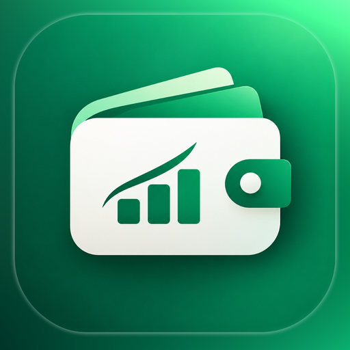
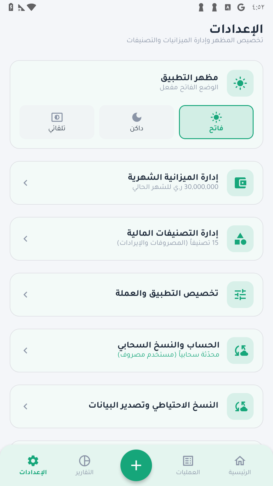
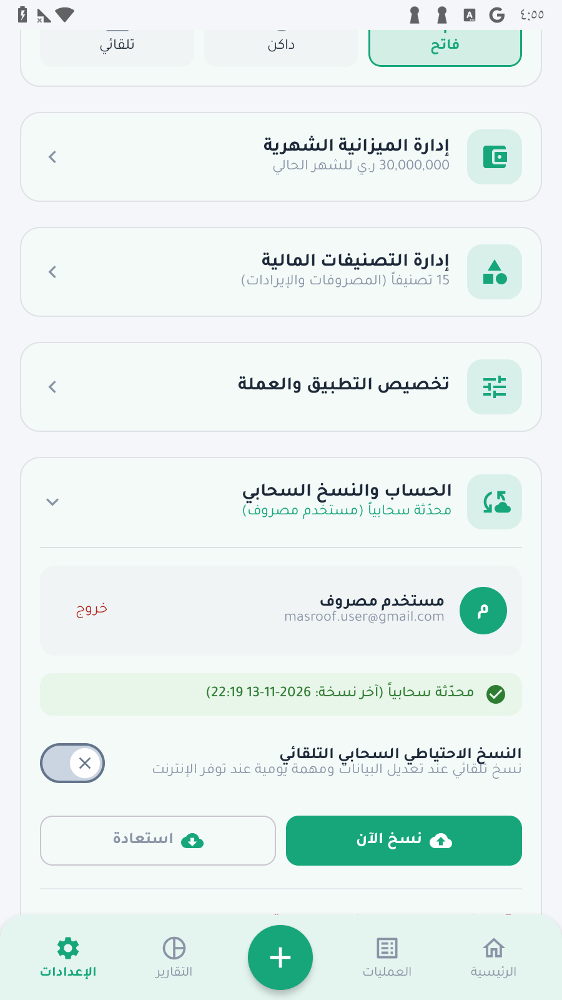

<div dir="rtl" align="right">

# تطبيق مصروف (<code>Masroof</code>)
### الحل المالي الذكي لإدارة النفقات الشخصية وتخطيط الميزانيات الشهرية بالعملات العربية والنسخ السحابي المشفر

<p align="center">
  
  <br />
  <strong>مصروف (Masroof)</strong> هو تطبيق أندرويد مالي متكامل مبني بفلسفة <strong>العمل دون اتصال أولاً (<code>Offline-First</code>)</strong>، صُمم خصيصاً للمستخدم العربي لتمكينه من متابعة وإدارة نفقاته اليومية، وتخطيط ميزانياته الشهرية، وتحليل تدفقاته النقدية بدقة وسهولة، مع دعم كامل لكافة العملات العربية والنسخ الاحتياطي السحابي المشفر واختياري 100%.
</p>

<p align="center">
  
  
  
  
  
  
  
</p>

---

## الفهرس
1. [نظرة عامة على التطبيق](#نظرة-عامة-على-التطبيق)
2. [الميزات والخصائص الرئيسية في الإصدار v1.1.0](#الميزات-والخصائص-الرئيسية-في-الإصدار-v110)
3. [معرض الشاشات المحدث](#معرض-الشاشات-المحدث)
4. [البنية المعمارية وهندسة البرمجيات](#البنية-المعمارية-وهندسة-البرمجيات)
5. [الأمان والخصوصية والامتثال لمتجر Google Play](#الأمان-والخصوصية-والامتثال-لمتجر-google-play)
6. [حزم النشر وطريقة التثبيت](#حزم-النشر-وطريقة-التثبيت)
7. [منظومة الاختبارات وضمان الجودة](#منظومة-الاختبارات-وضمان-الجودة)
8. [الترخيص وحقوق الاستخدام](#الترخيص-وحقوق-الاستخدام)

---

## نظرة عامة على التطبيق

يقدم تطبيق **"مصروف"** تجربة مالية متطورة تلبي احتياجات المستخدم العربي من خلال الدمج بين السرعة الفائقة والخصوصية المطلقة. يعمل التطبيق محلياً دون اشتراط أي اتصال بالشبكة، مع توفير خيار سحابي ذكي وآمن للنسخ الاحتياطي عبر حساب Google Drive الشخصي للمستخدم، مما يتيح استرجاع البيانات بسلاسة عند تغيير الجهاز أو فقدانه دون تعريض البيانات لأي استغلال تجاري أو إعلاني.

---

## الميزات والخصائص الرئيسية في الإصدار v1.1.0

### 1. دعم شامل لـ 24 عملة عربية رسمية
- تغطية متكاملة لجميع عملات الدول العربية (الريال السعودي، الجنيه المصري، الدرهم الإماراتي، الدينار الكويتي، الدينار الأردني، الريال اليمني، الدينار العراقي، الدرهم المغربي، وغيرها).
- مرونة تامة في تخصيص موضع رمز العملة (قبل الرقم أو بعد الرقم) لتلائم عادات القراءة المحلية.
- نظام ترقيم مالي دقيق يعتمد على الأرقام الصحيحة الخالية من الكسور العشرية غير الواقعية.

### 2. استعراض وتحليل زمني مرن
- فلاتر زمنية متعددة للاستعراض السريع: (اليوم، الأسبوع الحالي، الشهر الحالي، فترات مخصصة، وتاريخ يوم محدد).
- إمكانية طي وتوسيع الأيام السابقة في سجل العمليات بضغطة واحدة لمنح واجهة نظيفة وتسهيل التركيز على الأيام النشطة.
- عرض أسماء الأيام باللغة العربية الفصحى (السبت، الأحد، ...) مع التواريخ القياسية.

### 3. النسخ الاحتياطي السحابي والمحلي فائق الأمان
- **نسخ سحابي اختياري مشفر:** تشفير كامل بمعيار <code>AES-256</code> مع ضغط البيانات بتقنية <code>GZIP</code> واحتساب بصمة <code>SHA-256</code> لضمان عدم تعرض الملفات لأي تعديل أو تلف أثناء النقل عبر <code>Firebase Authentication</code> و <code>Cloud Firestore</code>.
- **مزامنة تلقائية ذكية:** مزامنة خلفية مجدولة عبر <code>WorkManager</code> عند الاتصال بالشبكة وتعديل السجلات.
- **نسخ احتياطي محلي:** تصدير واسترجاع نسخة كاملة بصيغة <code>JSON</code> مع استعادة ذرية محمية بمعاملة قاعدة البيانات.
- **تصدير التقارير (<code>CSV</code>):** تصدير سجل العمليات متوافقاً مع برامج الجداول الإلكترونية مع وسم <code>UTF-8 BOM</code> لضمان سلامة النصوص العربية.

### 4. تقارير مالية ورسوم بيانية تفاعلية
- **المخطط الدائري المجوف (<code>Donut Chart</code>):** رسوم بيانية ذات مظهر زمردي فاخر مع بطاقات دلالة التصنيفات وتكبير تفاعلي للشرائح المختارة.
- **مخطط أسابيع الشهر:** توزيع النفقات على الأسابيع الأربعة مع إبراز أسبوع الذروة.
- **مخطط المقارنة الشهرية:** مقارنة الإنفاق عبر آخر 6 أشهر مع حساب نسب التغير المئوية.

### 5. هوية بصرية زمردية متناسقة
- هوية لونية هادئة وفخمة تعتمد على اللون الأخضر الزمردي الملكي في كافة الأيقونات والقوائم.
- بطاقات إعدادات موحدة في الهيكل البصري، الإطارات، وظلال الارتفاع، وأبعاد حاويات الأيقونات.
- دعم أصيل للوضع الفاتح (<code>Light Theme</code>) والوضع الداكن (<code>Dark Theme</code>) والاتجاه العربي من اليمين إلى اليسار (<code>RTL</code>).

---

## معرض الشاشات المحدث

<div align="center">

| الشاشة الرئيسية | سجل المعاملات والتحليل الزمني | التقارير والمخططات البيانية | شاشة الإعدادات الموحدة |
| :---: | :---: | :---: | :---: |
|  |  |  |  |

| بطاقة النسخ السحابي الموسعة | نافذة تسجيل الدخول الآمن | تخصيص العملة والموضع | الأيقونة في مشغل التطبيقات |
| :---: | :---: | :---: | :---: |
|  |  |  |  |

</div>

---

## البنية المعمارية وهندسة البرمجيات

تم بناء المشروع باتباع أحدث توصيات هندسة البرمجيات الرسمية من جوجل (<code>Clean Architecture + MVVM</code>) مقسماً إلى طبقات معزولة تماماً:

<div dir="ltr" align="left">

```
app/src/main/kotlin/com/masroofi/app/
│
├── data/                         # طبقة البيانات (Data Layer)
│   ├── backup/                   # إدارة النسخ الاحتياطي المحلي والسحابي والتشفير
│   ├── dao/                      # واجهات الاستعلام من قاعدة البيانات المحلية (Room DAOs)
│   ├── database/                 # تهيئة قاعدة البيانات المحلية MasroofiDatabase مع الترحيل
│   ├── entity/                   # جداول قاعدة البيانات والكيانات
│   ├── export/                   # تصدير تقارير CSV مع دعم ترميز UTF-8 BOM
│   ├── preferences/              # إدارة تفضيلات المظهر والعملة عبر Jetpack DataStore
│   ├── repository/               # تنفيذ المستودعات وإدارة التدفقات
│   └── worker/                   # المهام المجدولة للنسخ التلقائي عبر WorkManager
│
├── domain/                       # طبقة النطاق وقواعد العمل (Domain Layer)
│   ├── calculations/             # محرك الحسابات والمؤشرات المالية الدقيقة
│   ├── model/                    # نماذج البيانات المجردة (Currency, Category, Transaction...)
│   ├── repository/               # واجهات المستودعات المجردة
│   └── usecase/                  # حالات الاستخدام المستقلة (Use Cases)
│
├── presentation/                 # طبقة العرض والواجهات (Presentation Layer)
│   ├── components/               # المكونات المشتركة، بطاقات الإعدادات، ومحول فواصل الآلاف
│   ├── navigation/               # محرك التنقل وشريط القوائم السفلي
│   ├── screens/                  # الشاشات الرئيسية الخمس ونماذج العرض (ViewModels)
│   └── theme/                    # منظومة الألوان الزمردية، الخط العربي Tajawal وتنسيقات Material 3
│
└── utils/                        # أدوات مساعدة لتنسيق الأرقام والتواريخ والعملات
```

</div>

---

## الأمان والخصوصية والامتثال لمتجر Google Play

1. **الخصوصية أولاً (<code>Zero Tracking</code>):** لا يطلب التطبيق أي أذونات تتبع إعلانية، ولا يجمع أي معلومات شخصية بشكل إلزامي.
2. **التشفير السحابي التام:** كافة الاتصالات السحابية مشفرة ببروتوكول <code>TLS / HTTPS</code>، والملفات مشفرة ومحمية بقواعد أمان صارمة في <code>Firestore Security Rules</code> تمنع أي وصول خارجي.
3. **الامتثال التام لقسم أمان البيانات (<code>Data Safety</code>):**
   - تم إعداد دليل تعبئة نموذج أمان البيانات المعتمد: [DATA_SAFETY_GUIDE.md](file:///c:/Users/MC/Desktop/my%20project2/Masroofi/docs/playstore/DATA_SAFETY_GUIDE.md).
   - صفحة سياسة الخصوصية الرسمية: `docs/privacy/index.html`.
   - آلية وصفحة طلب حذف الحساب والبيانات السحابية: `docs/delete-account/index.html`.

---

## حزم النشر وطريقة التثبيت

تم توليد وتوقيع حزمتي النشر الرسميتين للإصدار <code>v1.1.0</code>:

| الحزمة | المسار | الحجم | الغرض والاستخدام |
| :--- | :--- | :---: | :--- |
| **Google Play App Bundle** | `Masroof-v1.1.0.aab` | 16.78 ميجابايت | الرفع المباشر إلى لوحة تحكم متجر Google Play Console. |
| **حزمة التثبيت المباشرة (APK)** | `Masroof-v1.1.0.apk` | 17.26 ميجابايت | التثبيت الفوري والمباشر على أي هاتف أندرويد أو محاكي. |

### أوامر البناء والتثبيت عبر الطرفية:

1. **بناء حزمة متجر جوجل بلاي الرسمية (AAB):**
<div dir="ltr" align="left">

```powershell
.\gradlew.bat bundleRelease
```

</div>

2. **بناء حزمة التثبيت المباشرة (APK):**
<div dir="ltr" align="left">

```powershell
.\gradlew.bat assembleRelease
```

</div>

3. **تثبيت التطبيق على الجهاز أو المحاكي المتصل:**
<div dir="ltr" align="left">

```powershell
adb install -r Masroof-v1.1.0.apk
```

</div>

---

## منظومة الاختبارات وضمان الجودة

يحتوي المشروع على حزمة اختبارات وحدة آلية متكاملة تضمن دقة كافة العمليات الحسابية والترحيل وقواعد البيانات:

<div dir="ltr" align="left">

```powershell
.\gradlew.bat testDebugUnitTest
```

</div>

- **النتيجة:** نجاح كامل بنسبة 100% لكافة الاختبارات الآلية (Zero Failures).

---

## الترخيص وحقوق الاستخدام

هذا المشروع مطور كمنتج برمجي حر وعالي الجودة للمستخدم العربي.
جميع الحقوق محفوظة للمطور © 2026.

</div>
